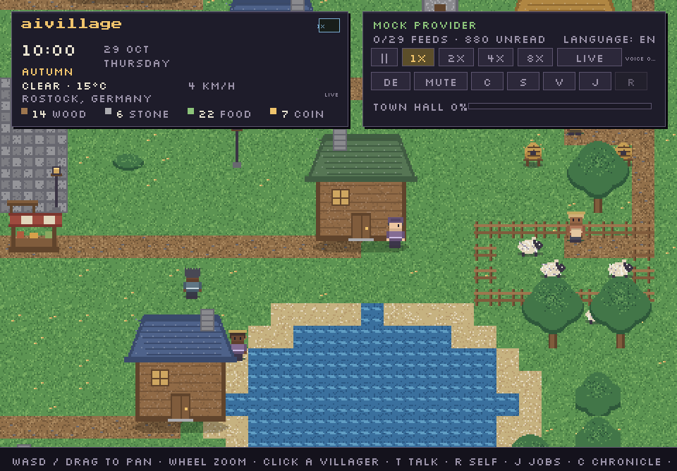

# aivillage

A small pixel-art village that lives on **your** clock, **your** weather and the **real news**.



Nineteen villagers — sixteen adults and three children — with their own jobs, voices and relationships
work through a real day: Pip waters turnips, Marrow hammers iron, Maude keeps the sheep, Greta cuts
wood, Corin works the quarry, Bram raises the town hall, Wisp only comes out at night, and the
children go to lessons, play, and dream about who they will become. In their free time they talk to
each other — every line generated by a language model in their own voice. Now and then a stranger
walks in from the road carrying a real-world headline, retold as village gossip, and the village
gathers at the bell to hear it.

Nothing is scripted: dialogue is LLM-only, the date and season are real, the sky matches Open-Meteo,
and the village sleeps when you do. Left alone with a real provider, villagers also reshape
themselves: they may choose a new trade, write their own ambition and background, and pick a hat and
outfit.

> Status: v0.4, playable. See [`PROGRESS.md`](PROGRESS.md) for exactly what is and is not done.

---

## Quick start

On Windows, double-click **`Start aivillage.cmd`**. The first launch sets up the game components
and may need an internet connection. If asked, install Python 3.12 and double-click again. Your
existing `.venv` folder is never deleted or replaced by the launcher.

For a free local AI, open **F3 → AI SETUP**, choose **Ollama (local)** and use **OPEN WEBSITE** to
install Ollama. Open Ollama, then select **DOWNLOAD MODEL** in the game (roughly 2 GB). Once the
download finishes, save your choice and restart the game. The download only starts when you click
the button. For a quick look without setting up AI, choose **Try the village (demo)** instead;
demo replies are preset, not generated by an AI.

### Manual setup

Requires **Python 3.11–3.12** on Windows (SAPI voice is Windows-only; the rest is cross-platform).
Do not use Python 3.14 — the wheels are not there yet.

```powershell
cd path\to\aivillage

# with uv
uv venv --python 3.12
.\.venv\Scripts\Activate.ps1
uv pip install -e ".[dev]"

# or with plain venv
py -3.12 -m venv .venv
.\.venv\Scripts\Activate.ps1
pip install -e ".[dev]"

python run.py
```

The village opens without any API key. Press **F3 → AI SETUP** to choose a provider and see its
setup instructions; if no provider is available, the startup card also offers **SETUP**. Save your
choice and restart the game. Without a model, the village still runs, but conversations and
traveller dispatches stay quiet.

```powershell
python run.py --new                 # ignore the save and start a fresh village
python run.py --lang de             # start in German
python run.py --provider mock       # offline demo dialogue (flat, for testing only)
python run.py --location Leipzig    # override the detected city
python run.py --zoom 4 --width 1600 --height 900
```

## Give it a mind

Any of these work; the adapter is provider-agnostic.

The setup screen stores provider and non-secret gateway settings in `aivillage-setup.json` beside the active
`config.toml` (or your `--config` file). It does not store API keys or passwords. A saved choice
overrides `llm.provider` in the config file; `--provider` overrides both for that launch. Choose
**Automatic** in the setup screen to return to automatic provider detection.

| Provider | Setup |
|---|---|
| **Ollama** (default) | Install [Ollama](https://ollama.com), `ollama pull llama3.2`, keep it running |
| **OpenAI** | Copy `.env.example` → `.env`, set `OPENAI_API_KEY` |
| **Anthropic** | Set `ANTHROPIC_API_KEY` in `.env` |
| **Claude subscription** | Install Claude Code, run `claude` once to sign in, set `provider = "claude_cli"` |
| **ChatGPT subscription** | Install Codex, run `codex` once to sign in, set `provider = "codex_cli"` |
| **Either subscription** | `provider = "subscription"` — tries Claude, then Codex |
| **OpenAI-compatible** | `provider = "openai_compatible"`, `base_url = "http://localhost:1234/v1"` (LM Studio, vLLM, …) |
| **None / mock** | `--provider none` or `--provider mock` |

### Custom AI gateway

Open **F3 → AI SETUP → OpenAI-compatible → CONFIGURE GATEWAY**. Enter the gateway's base URL
(for example `https://gateway.example/v1`), its model ID and, if authentication is required, the
**name** of the environment variable holding its bearer token (for example `GATEWAY_API_KEY`).
Save and restart. The endpoint must support OpenAI-compatible `POST /chat/completions` with
`choices[0].message.content`; arbitrary gateway protocols, Azure-specific authentication and
custom headers are not supported. A full `/chat/completions` URL is accepted as well.

Set the token in the process environment or in `.env` in the app's data directory before starting;
do not type the token into the setup screen or commit it. On Windows that directory is
`%LOCALAPPDATA%\aivillage` for the built app, or the project directory for a source run. The app
stores only the variable name. Remote HTTP sends prompts and tokens unencrypted; use HTTPS for remote
gateways. Redirects, embedded URL credentials and query parameters are rejected. Requests (including
automatic village conversations) are sent to the configured gateway and may incur usage costs.

Alternatively configure `provider = "openai_compatible"`, `base_url`, `model` and `api_key_env`
under `[llm]` in `config.toml`. A gateway saved through the setup screen overrides those fields while
that provider is selected. If no token is needed, leave the environment-variable name blank.

A **subscription is not an API key.** ChatGPT Plus/Pro and Claude Pro/Max cannot be called as a
normal API. The subscription connectors drive the official logged-in CLIs instead
(`claude -p` and `codex exec`), which reuse the login those apps already stored. Villagers make short
calls one at a time, so expect a few seconds of latency and normal subscription rate limits.
`prefer_subscription = true` makes `provider = "auto"` try a signed-in CLI before API keys.

You can also pin a provider/model in `config.toml`:

```toml
[llm]
provider = "ollama"
model    = "llama3.2"
# or:
# provider = "subscription"
# prefer_subscription = true
# cli_model = "sonnet"
```

Copy `config.example.toml` to `config.toml` to change anything else (window, zoom, seed, weather,
voice, news weights, visitor count). Every key has a default; a missing config file is fine.

## Controls

| Input | Action |
|---|---|
| Left click | Select a villager or traveller |
| Drag / WASD / arrows | Pan |
| Mouse wheel | Zoom (integer 2–5) |
| `T` or inspector button | Chat with the selected villager |
| `R` or SELF button | Let the selected villager decide who they want to be |
| `J` | Callings panel: every trade and who holds it |
| `Space` | Pause |
| `1` `2` `3` `4` | Speed ×1 ×2 ×4 ×8 (leaves live mode) |
| `L` | Return to live (your real clock) |
| `N` | Sleep until dawn |
| `C` | Chronicle (news, events, daily diary) |
| `V` | Ask a traveller to come now |
| `M` | Mute/unmute voice |
| `S` | Save |
| `F2` | Switch English ↔ German |
| `F3` | Settings and five save slots |
| `F10` | Toggle photo mode (hides the interface) |
| `F11` | Export a postcard to `data/` while in photo mode |
| `F12` | Screenshot to `data/` |
| `Esc` | Close panel / deselect |

Chat supports typing, Backspace and Ctrl+V paste. Enter sends.
The F3 conversation toggles last for the current session. Saving overwrites the selected slot;
autosave follows the last successfully saved or loaded slot. A slot with a different world seed
cannot be loaded into the current village.

Automatic dialogue backs off after provider errors; player-initiated chat and self-direction are
not subject to that retry delay. `llm.cache_entries` limits the in-memory cache for exact matching
requests (set it to `0` to disable caching). See `config.example.toml` for retry settings.
With conversation threads enabled in F3, delivered lines are saved per pair of villagers and recent
lines are included in future pair and group prompts. Each thread retains at most 24 lines.
At a new in-game day, a real model can continue a saved village story using recent chronicle events;
the current story is included as background in conversations. Turn this off with
`social.story_arcs = false`. It makes an additional model request per day and may incur charges.
Packaged builds check GitHub Releases in the background. When a newer version is found, press **U**
to download and verify the matching platform installer, then launch its normal installer prompts.
Updates are never silently installed or allowed to replace saves/configuration. Maintainers publish
releases by pushing a `v*` tag; releases include SHA-256 checksums used by the updater.
Click a house entrance to view its cutaway interior; press **Esc** to return to the village.
Up to three independent villager conversations can overlap, with sequential turns within each
conversation and separate Windows SAPI playback. Two background model requests may run at once,
which can increase provider usage or local model load. Under
**F3 → CHAT MODEL**, you can optionally enter a different model ID for automatic conversations;
it must already be available to the selected provider. Leave the field empty to use the normal
model. With the Codex CLI, background conversations request low reasoning effort by default;
`llm.ambient_reasoning_effort = ""` restores the CLI default. Set `llm.parallel_ambient = false`
and restart if parallel requests overload your local model or provider.
Villagers now speak free-time conversations aloud by default; toggle this in **F3 → Voices in
conversations**, or mute all speech with **M**. Speech uses the offline Windows SAPI voices
installed on the computer. If a preferred voice is missing, another installed voice is used; voice
rate and volume still vary by villager. A working AI provider is needed for generated dialogue.

## What is real

- **Clock:** live by default — the village clock *is* your clock. Fast-forward detaches it; a badge
  shows it and `L` re-syncs.
- **Date/season/sun:** real date, weekday, season, sunrise and sunset drive lighting and schedules.
- **Weather:** current conditions from [Open-Meteo](https://open-meteo.com) (keyless), refreshed
  every 15 minutes and cached. If the network is down, the last known weather or a seasonal
  simulation is used. Rain, snow, fog and storms are drawn and affect what villagers do.
- **Location:** auto-detected via [ipwho.is](https://ipwho.is). Override with `--location`.
- **Weather warnings:** where available, Bright Sky/DWD alerts can be retold by a courier using a
  real language-model provider. Retellings can be delayed or inaccurate; this is not an emergency
  warning system, so consult official warnings directly.
- **News:** 29 keyless RSS feeds (BBC, Guardian, NPR, Al Jazeera, DW, Tagesschau, ZDF, DLF,
  Spiegel, Zeit, taz, Heise, Ars Technica, NASA, Nature, Atlas Obscura, BBC Sport, …). Headlines are
  deduplicated in SQLite, filtered for distress, weighted by category and language, and adapted by
  the LLM into a village-appropriate retelling. The original headline and source link stay in the
  Chronicle.
- **Travellers:** always newly generated strangers — name, trade, origin, look and voice are rolled
  fresh each time. They are not a recurring cast.
- **Children:** Nettle, Jory and Pella live with their parents, attend lessons, play in the afternoon
  and have smaller sprites. They do no adult work and produce nothing, but they have their own
  voices, friendships and dreams. Ask one with `R` and it will choose a trade it hopes to learn.
- **Resource trades:** Maude Ash shepherds the east pasture, Ivo Thrum keeps the hives, Greta Fenn
  works the south woodlot and Corin Slate quarries stone at the west edge. Each has a home, a visible
  work site and a tool, and each feeds the same wood/stone/food stores as the older trades.
- **Self-direction:** with a real provider, villagers periodically rewrite themselves — a new trade,
  a one-line ambition, a short bio, a quirk, a hat and an outfit. Values are validated against the
  job registry, so a model cannot invent a trade or corrupt a save. Children choose a `dream_job`
  instead of changing jobs. Mock mode never does this, so tests and demos stay deterministic.

## Privacy and network

The game talks to: Open-Meteo (weather), ipwho.is (coarse IP location), the RSS feeds, and your LLM
provider (Ollama locally, the API you configure, or the Claude Code / Codex CLI you signed in to).
Nothing is sent anywhere else; no telemetry, no accounts. `data/` and `saves/` stay on your machine.

## Build a desktop app

On Windows, double-click **`Build aivillage.cmd`** and confirm the download. On Windows, macOS or
Linux, you can also run `python build_app.py --install` using Python 3.11 or 3.12. The builder puts
the app in `dist/<platform>-<architecture>/` and will not overwrite an existing build.

After building, run `python build_installer.py` (or double-click **`Build installer.cmd`** on
Windows) to create a Windows installer, macOS disk image, or Debian package in `dist/installers/`.
Windows requires Inno Setup 6.7 or newer, macOS requires `dmgbuild`, and Debian packaging requires
`dpkg-deb`.

Build on each target operating system; the builder does not cross-compile. GitHub Actions can build
all three on their respective runners. See [BUILDING.md](docs/BUILDING.md) for distribution, data
locations, signing and platform limitations.

## Project layout

```
run.py                  launcher and CLI
config.example.toml     all settings, documented
aivillage/
  app.py                controller: loop, input, simulation, visitors, save/load
  config.py  i18n.py    config + runtime language
  reality/              clock, Open-Meteo weather, location
  world/                map generation, objects, A* pathfinding
  agents/               personas, roster, jobs, needs, memory, animation, brain, visitors
  llm/                  provider + subscription-CLI adapters, worker queue, prompts, JSON parsing
  news/                 feeds, distress filter, SQLite store, pipeline
  voice/                pyttsx3 worker, per-villager voices
  render/               camera, world renderer, HUD/inspector/chronicle/chat/jobs
  assets/               procedural sprites, palette, fonts, procedural SFX
tests/                  headless tests, including a loopback gateway integration test
docs/DECISIONS.md       deviations from the plan and why
```

The design and build plan is [`PLAN.md`](PLAN.md); what is finished is
[`PROGRESS.md`](PROGRESS.md).

## Tests

```powershell
.\.venv\Scripts\python.exe -m pytest -q
```

Tests run headless (`SDL_VIDEODRIVER=dummy`), with a mock LLM or a local loopback gateway, a fixed ordinary Thursday
(`2026-10-29 10:00`), a clear weather state and an isolated news database. The fixed date matters:
using the real date made production tests fail on rest days and holidays. The suite covers world
generation and pathfinding, crop/build cycles, weather/clock/season maths, locale key parity, news
filtering and storage, the dispatch/rumour pipeline, chat round-trips, input, save/load, jobs and
children, self-authored identities, subscription-CLI command shape/parsing, day/night rendering and
HUD hit targets.

## Troubleshooting

| Symptom | Fix |
|---|---|
| No dialogue, setup card visible | No model found: run Ollama or set a key in `.env`, then press the retry button |
| Subscription selected but no dialogue | Run `claude` or `codex` once in a terminal to sign in; check `llm.claude_command` / `codex_command` and `cli_timeout_s` |
| `claude -p` reports a billing/card error | The Claude subscription itself is not active; finish the Claude account check or use an API key/Ollama |
| Voice is silent | Windows SAPI only; press `M` (it may be muted), check `voice.enabled` |
| German text has missing glyphs | Use the bundled fonts (already in `assets/fonts`); don't delete them |
| Weather never updates | Blocked network; the village falls back to cached/seasonal weather |
| `pip install` fails on Python 3.14 | Use Python 3.12 (`uv venv --python 3.12`) |
| Window is small | The window is clamped to your desktop; pass `--width/--height` |

## Known gaps

- Gateway support requires the OpenAI Chat Completions protocol; custom headers and other protocols
  are not yet supported. Actual voice playback and installer behavior depend on the target system.
- Interiors are currently simple cutaway rooms; richer furnished interiors remain a stretch goal.
- Native installer installation and the tagged-release updater flow still need end-to-end checks on each OS.

Details in [`PLAN.md`](PLAN.md) §0 and [`PROGRESS.md`](PROGRESS.md).

## Credits

Art is generated at runtime — no image assets. Fonts: **Silkscreen** and **Press Start 2P**, both
under the SIL Open Font License (licence files in `aivillage/assets/fonts/`). Weather by Open-Meteo.
News belongs to its publishers; only short retellings and links are shown.
